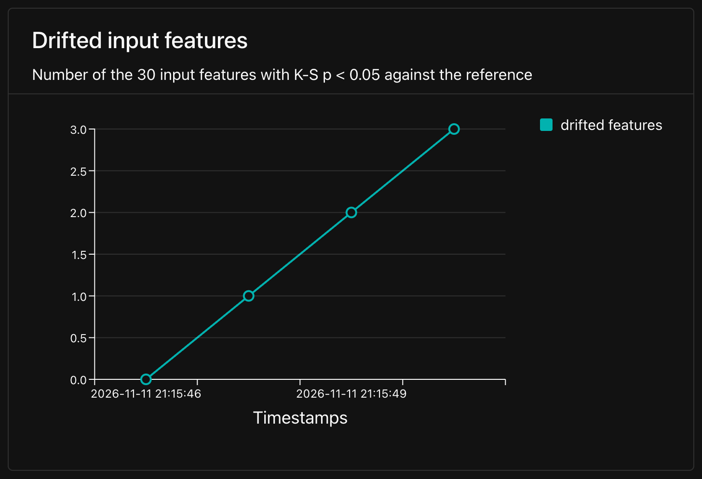
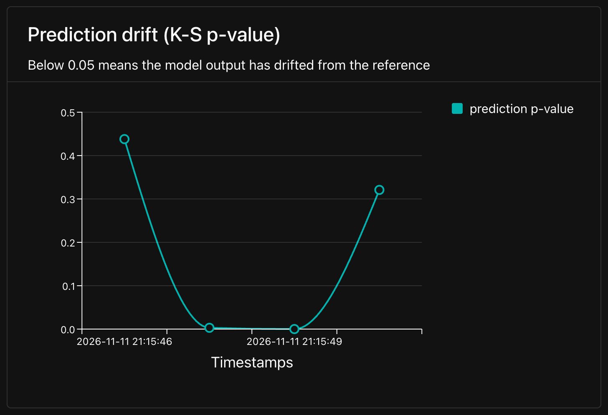
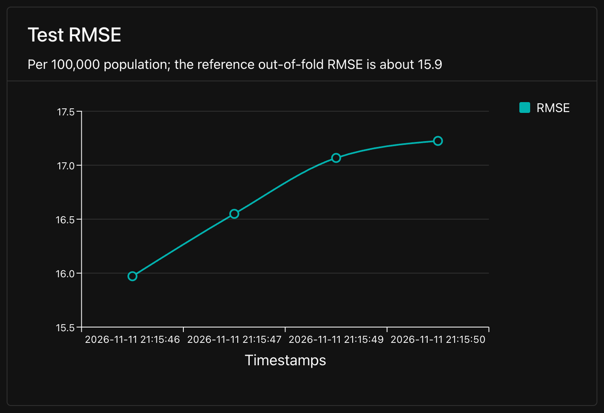
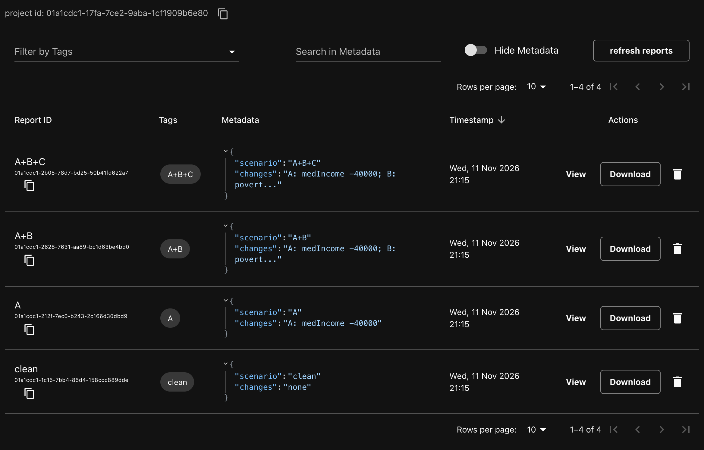
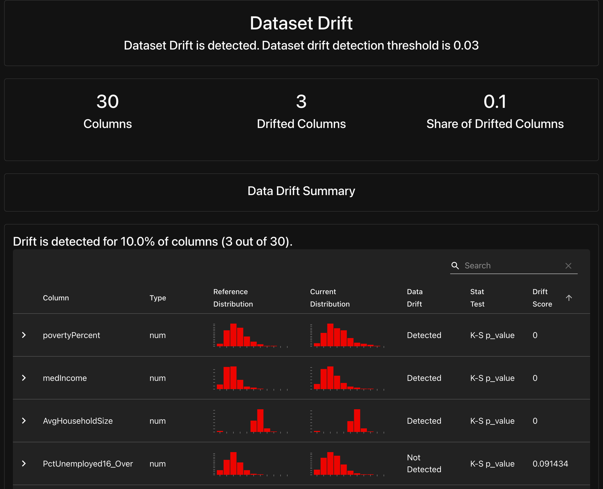
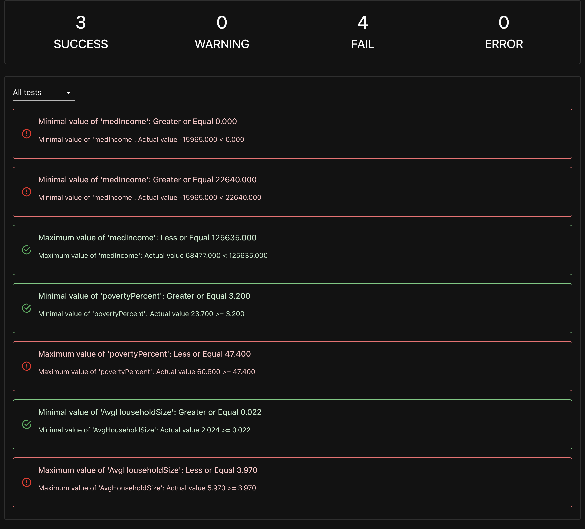
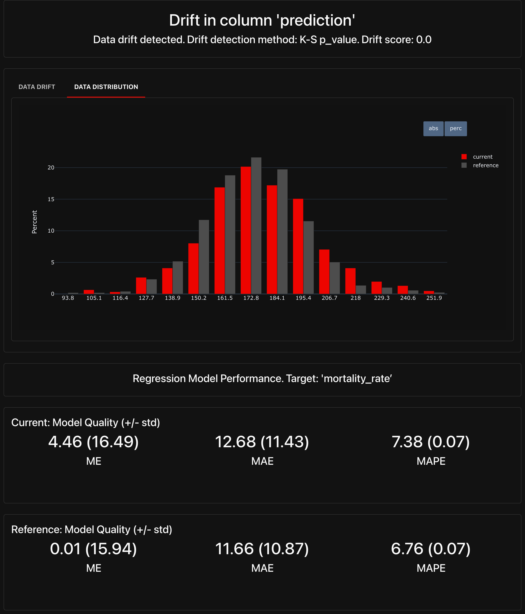
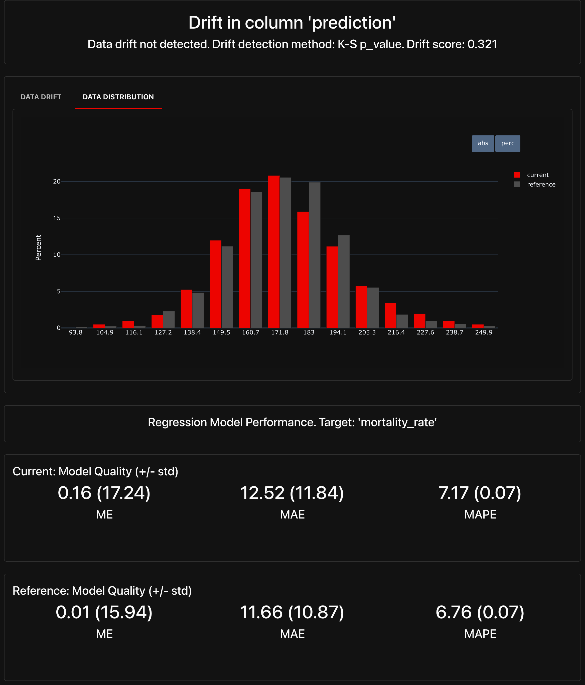

# County Cancer Outcomes: Model Monitoring with Evidently

This repository trains a model that predicts each US county's cancer mortality rate (`mortality_rate`, per 100,000 population) from census and health statistics, then monitors it with Evidently. The clean test set gives the accuracy baseline. Three altered copies of the test set simulate a broken upstream data feed, and Evidently reports how each change shows up in the model's inputs, its output, and its accuracy.

*ADSP 32021 Machine Learning Operations, University of Chicago M.S. Applied Data Science*

## Goals

The brief asks for the following:

1. Train a model on `cancer_reg.csv` that predicts the cancer mortality rate (`TARGET_deathRate` in the source CSV), using a train/test split.
2. Set up model monitoring with Evidently.
3. Evaluate the model's accuracy on the test set.
4. Alter the test set cumulatively in three instances: A, then A and B, then A, B, and C, where
   - A decreases `medIncome` by 40,000,
   - B increases `povertyPercent` by 20 points,
   - C increases `AvgHouseholdSize` by 2.
5. For each instance, score the model, check its accuracy, and use monitoring to detect the changes in the inputs and in the model output.

## Data and context

The dataset describes US counties in aggregate and contains no records for individual people. Each mortality rate still stands for people and families in those communities, so this repository uses public-health terminology throughout. The model was built for a course exercise in model monitoring and is not intended to guide decisions about individuals or real resource allocation.

## Business context

Public-health teams use county-level estimates like these to direct prevention and screening resources to the communities with the greatest need. The model's inputs arrive from outside feeds such as the Census Bureau's surveys, and a feed can break without any error: an income column shifted by a fixed offset, a percentage reported on the wrong base, or household size computed from the wrong denominator. The model still returns numbers, so nobody notices until the decisions built on them go wrong. Monitoring compares every new batch of inputs and predictions with a trusted reference and raises an alert as soon as the distributions or value ranges move, which is the failure this project simulates.

## Stack

| Role | Tool |
|---|---|
| Model | scikit-learn `HistGradientBoostingRegressor` |
| Monitoring | Evidently 0.7 (reports, tests, and a local self-hosted workspace) |
| Experiment tracking | MLflow, with a SQLite backend (`mlflow.db`) |
| Entry point | `pipeline.py` |

## Pipeline

```
cancer_reg.csv
   │  src/data_prep.py   drop 3 columns, 80/20 split (seed 42), EDA summary
   ▼
train split ──► src/train.py   5-fold out-of-fold predictions ─► reference set
   │                           final model fit on the full train split
   ▼
clean test set (base version, never modified)
   │  src/scenarios.py   apply_changes(base_test, [...])
   ├─► clean   []
   ├─► A       ["A"]
   ├─► A+B     ["A", "B"]
   └─► A+B+C   ["A", "B", "C"]
         │  score with the model, compute RMSE / MAE / R²
         ▼
   src/monitor.py   same Evidently report for every run, compared with the reference
         │          HTML + JSON to results/, run added to the Evidently workspace, logged to MLflow
         ▼
   src/compare.py   comparison table and plots
```

### Data preparation

The dataset has 3,047 counties and 34 columns. Three columns are dropped:

| Column | Reason |
|---|---|
| `Geography` | the county name, a unique identifier with no predictive meaning |
| `binnedInc` | a decile bin of `medIncome`; change A alters `medIncome` without updating the bin, so the model would see two income values that disagree |
| `PctSomeCol18_24` | missing for most counties |

`PctEmployed16_Over` and `PctPrivateCoverageAlone` have some missing values. `HistGradientBoostingRegressor` handles missing values natively, so no imputation is needed. `results/eda_summary.csv` lists missing counts, ranges, and the correlation of every column with the target.

The original data dictionary calls the income column `medianIncome`, and the CSV header calls it `medIncome`. The code uses the CSV names, except that it renames the target `TARGET_deathRate` to `mortality_rate` on load (`SOURCE_RENAMES` in `src/config.py`). [data/data_dictionary.md](data/data_dictionary.md) gives the definitions.

### Model

The split is 80/20 with `random_state=42`. The test set is used only to measure accuracy and as the monitored data. The model's settings are in `src/config.py`. A gradient-boosted tree model handles the skewed, correlated census features without scaling.

### Reference set

Evidently compares each run with a reference dataset. The reference is the training split with out-of-fold predictions from 5-fold cross-validation. Each out-of-fold prediction comes from a model that never saw that county, so the reference's error level is comparable with the test set's. Because the reference and the clean test set are random samples of the same counties, the clean run checks that the monitor raises no false alarms on unchanged data.

### How the scenarios differ

Every scenario starts from a copy of the clean test set, so the clean test set acts as the base data version and is never modified. The function `apply_changes(base_test, changes)` builds each version, and every version passes through the same variable in `pipeline.py`.

| Scenario | Changes from the clean test set |
|---|---|
| clean | none |
| A | `medIncome` decreased by 40,000 |
| A+B | `medIncome` decreased by 40,000; `povertyPercent` increased by 20 points |
| A+B+C | `medIncome` decreased by 40,000; `povertyPercent` increased by 20 points; `AvgHouseholdSize` increased by 2 |

The changes are applied literally, as in the brief's example (43,823 becomes 3,823), so change A gives most counties a negative median income. The values are left unclipped, because impossible values from a broken feed are what monitoring should catch. `results/scenario_validation.md` shows the mean, minimum, and maximum of the three changed columns in each scenario, which confirms each change was applied.

Income correlates negatively with the mortality rate and poverty correlates positively, so changes A and B should both raise the predictions. A tree model predicts the same value for every input beyond the edge of its training range, so once a change pushes a column far out of range, its effect on predictions stops growing. This limits how far predictions and accuracy move.

### Monitoring report

Each run uses one report definition (`src/monitor.py`), in this order:

| Section | Evidently component | What it detects |
|---|---|---|
| Input drift | `DataDriftPreset` on the 30 features | which input columns changed distribution |
| Output drift | `ValueDrift` on `prediction` | whether the model's predictions changed distribution |
| Accuracy | `RegressionPreset` | RMSE, MAE, and error plots against the reference |
| Range alerts | `MinValue` and `MaxValue` tests on the three changed columns | values outside the training range, and negative income |

Drift uses the Kolmogorov-Smirnov test for every numeric column, and a column counts as drifted when p < 0.05. The method is fixed in `src/config.py` so every run uses the same test.

Evidently also reports whether the dataset as a whole has drifted, which by default requires half of the columns to drift. This project lowers that share to 0.03, so a single drifted feature out of 30 marks the dataset as drifted, because one broken upstream column is the failure being monitored.

### Evidently workspace

Each run is added to a local Evidently workspace under the project "County cancer outcomes monitoring". Every run carries its scenario as its name and tag, plus metadata that lists the changes applied, so the Reports list shows which test set each run used.

The project dashboard has three line panels, each with one point per run in run order:

| Panel | Metric |
|---|---|
| Drifted input features | count of drifted features from `DriftedColumnsCount` |
| Prediction drift (K-S p-value) | `ValueDrift` on `prediction` |
| Test RMSE | `RMSE` from `RegressionPreset` |

The dashboard is created together with the project, so it is built on the first run into an empty workspace.

## How to run

The project needs Python 3.10 or later. From the repository root:

```bash
python -m venv .venv
```

```bash
source .venv/bin/activate
```

```bash
pip install -r requirements.txt
```

The dataset is included at `data/cancer_reg.csv`. To use a different copy, set `export CANCER_CSV=/path/to/cancer_reg.csv`.

When rerunning the pipeline, first delete the `evidently_workspace/` folder, so the project holds only the four runs of the latest pipeline run. Skip this on the first run.

```bash
rm -rf evidently_workspace
```

Run the pipeline:

```bash
python pipeline.py
```

Open the Evidently UI at http://localhost:8000 to browse the dashboard and the four runs in the project "County cancer outcomes monitoring".

```bash
evidently ui --workspace ./evidently_workspace --port 8000
```

Open the MLflow UI at http://127.0.0.1:5001 to compare the training run and the four monitoring runs. Port 5001 avoids macOS AirPlay Receiver on port 5000.

```bash
mlflow ui --backend-store-uri sqlite:///mlflow.db --port 5001
```

## Results

The pipeline writes these files to `results/`:

| File | Contents |
|---|---|
| `comparison.md` / `.csv` | one row per scenario: RMSE, MAE, R², mean prediction, drifted features, prediction drift p-value, failed tests |
| `scenario_validation.md` / `.csv` | mean, minimum, and maximum of the three changed columns per scenario |
| `eda_summary.csv` | missing values, range, and target correlation of every numeric column |
| `evidently_reports/{scenario}.html` | full Evidently report for each run (`clean`, `a`, `a_plus_b`, `a_plus_b_plus_c`) |
| `evidently_reports/{scenario}.json` | the same report as JSON |
| `predicted_vs_actual.png` | predicted against actual mortality rate, one panel per scenario |
| `prediction_distribution.png` | distribution of predictions for the reference and each scenario |
| `rmse_by_scenario.png` | test RMSE per scenario |

`results/screenshots/` holds screenshots of the local Evidently UI, captured after a pipeline run and not written by the pipeline, which are listed under "Evidently UI" below.

### Accuracy and detection

The test set has 610 counties. Prediction drift is the Kolmogorov-Smirnov p-value of the predictions against the reference, flagged when p < 0.05.

| Scenario | RMSE | MAE | R² | Mean prediction | Drifted features | Prediction drift (p) | Failed tests |
|---|---|---|---|---|---|---|---|
| clean | 15.97 | 11.61 | 0.688 | 179.10 | none | no (0.44) | 0 |
| A | 16.55 | 12.25 | 0.665 | 181.92 | `medIncome` | yes (0.0029) | 2 |
| A+B | 17.07 | 12.68 | 0.644 | 183.34 | `medIncome`, `povertyPercent` | yes (0.00004) | 3 |
| A+B+C | 17.23 | 12.52 | 0.637 | 179.04 | `medIncome`, `povertyPercent`, `AvgHouseholdSize` | no (0.32) | 4 |

The cross-validated (out-of-fold) RMSE on the training split is 15.94, which matches the clean test RMSE of 15.97, so the reference set represents the model's normal error level.

### Findings

#### Clean test set

Evidently flagged no drifted features and no prediction drift, and every range test passed. The monitor raised no false alarm on data from the same distribution as the reference.

#### Instance 1: change A

Evidently flagged `medIncome` as the only drifted feature. Its minimum fell to −15,965, which failed both income tests: the rule that income cannot be negative, and the training minimum of 22,640. Predicted mortality rose by 2.8 per 100,000 population on average and the prediction distribution drifted (p = 0.0029). RMSE rose 3.6%, from 15.97 to 16.55.

#### Instance 2: changes A and B

Evidently flagged `medIncome` and `povertyPercent`. The poverty maximum of 60.6 exceeded the training maximum of 47.4, which added a third failed test. Lower income and higher poverty both point to a higher mortality rate, so the two changes pushed predictions the same way: the mean rose to 183.34 and the prediction drift became stronger (p = 0.00004). RMSE rose 6.9% over the clean set, to 17.07.

#### Instance 3: changes A, B, and C

Evidently flagged all three changed features, and the household-size maximum of 5.97 exceeded the training maximum of 3.97, for four failed tests. Accuracy was the worst of the four runs (RMSE 17.23, R² 0.637). The prediction distribution, however, returned close to the reference (mean 179.04, p = 0.32), so Evidently reported no output drift. The model associates the largest household sizes in its training data with lower mortality rates, and change C moved every county into that range, which offset the increase from A and B.

The bias tells the same story. Evidently's mean error (predicted minus actual) is +4.46 for A+B, where predictions run too high, and +0.16 for A+B+C, where the opposing changes cancel.

Output monitoring alone would have passed this batch as healthy, although its inputs were the most corrupted of the three. The input drift checks and range tests caught it.

#### Size of the accuracy loss

Accuracy fell by at most 8% even though change A made most incomes negative. A gradient-boosted tree splits on thresholds learned from the training data, so every income below the lowest threshold receives the same treatment as the lowest-income counties in the training data. The corrupted values therefore move predictions only as far as the edge of the training range, and the model keeps returning plausible-looking numbers. This is the reason accuracy metrics on their own are a weak alarm for broken inputs, and the reason the range tests are part of every run.

### Evidently UI

The screenshots come from the local Evidently UI after one pipeline run into an empty workspace.

| File | Shows |
|---|---|
| `01_dashboard_drifted_features.png` | dashboard panel: drifted input features rise 0, 1, 2, 3 across clean, A, A+B, A+B+C |
| `02_dashboard_prediction_drift.png` | dashboard panel: prediction drift p-value drops below 0.05 for A and A+B and returns to 0.32 for A+B+C |
| `03_dashboard_rmse.png` | dashboard panel: test RMSE rises from 15.97 to 17.23 |
| `04_reports_list.png` | the four runs with their scenario tags and the changes in their metadata |
| `05_abc_dataset_drift.png` | A+B+C report: dataset drift detected, with the drift table sorted by drift score showing the three changed columns |
| `06_abc_tests.png` | A+B+C Tests tab: four failed range tests on income, poverty, and household size |
| `07_ab_prediction_drift.png` | A+B report: prediction drift detected, mean error +4.46 |
| `08_abc_prediction_drift.png` | A+B+C report: prediction drift not detected (p = 0.321), mean error +0.16 |










## Repository layout

```
├── pipeline.py              entry point: runs every step in order
├── requirements.txt
├── data/
│   ├── cancer_reg.csv       dataset
│   └── data_dictionary.md   column definitions
├── results/                 tables, plots, and Evidently reports
└── src/
    ├── config.py            paths, seed, dropped columns, model settings, changes, drift method
    ├── data_prep.py         load, drop columns, split, EDA summary
    ├── train.py             model, out-of-fold reference set, metrics, scoring
    ├── scenarios.py         apply_changes and the validation table
    ├── monitor.py           Evidently schema, report, workspace, and summary
    └── compare.py           comparison table and plots
```

## Assisting sources

Claude Opus 5.5 (Anthropic).
